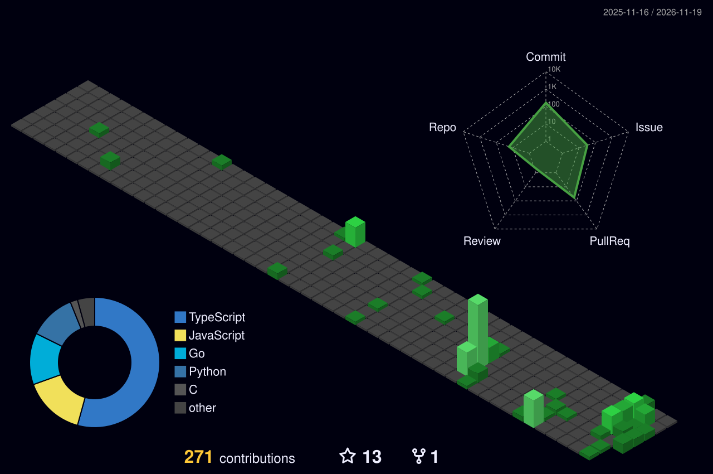
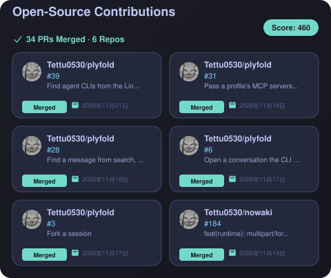

<h1 align="center">Hi there 👋 I'm tikisan</h1>

  

  こんにちは

---

## GitHub Stats

  

  

---

## Open Source Contributions

  

---

## Tech Stack

### プラットフォーム・OS

  

<strong>Proxmox VE</strong>

### 開発・インフラ

  

### 言語・マークアップ

  

---

## Links

  <a href="https://github.com/tikipiya">GitHub</a>
  ·
  <a href="https://x.com/tikisan_kosen">Twitter（旧 X）アカウント</a>
  ·
  <a href="https://p2.tikisan.space/">ポートフォリオサイト</a>

